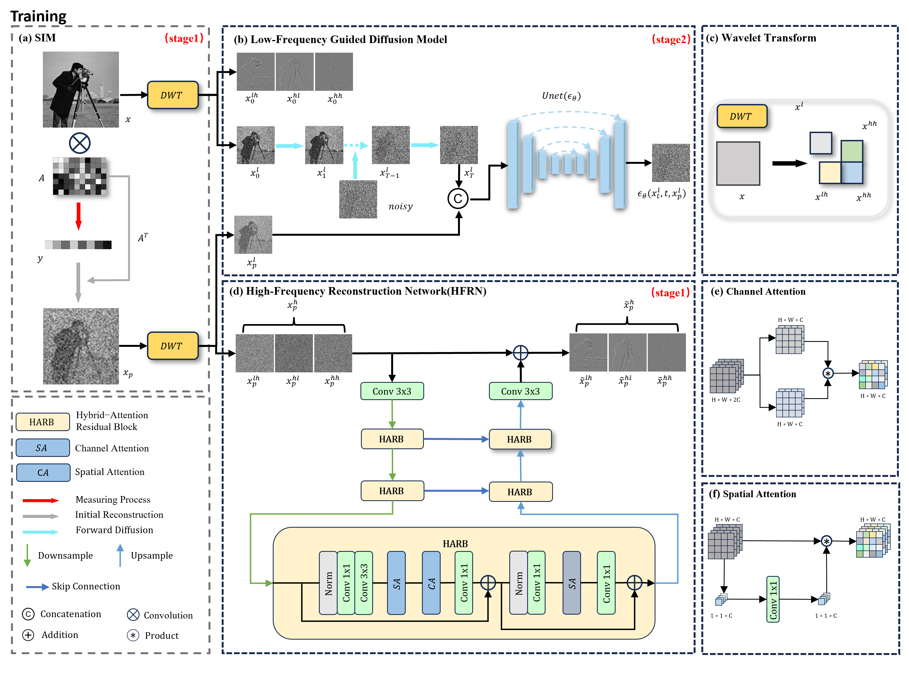
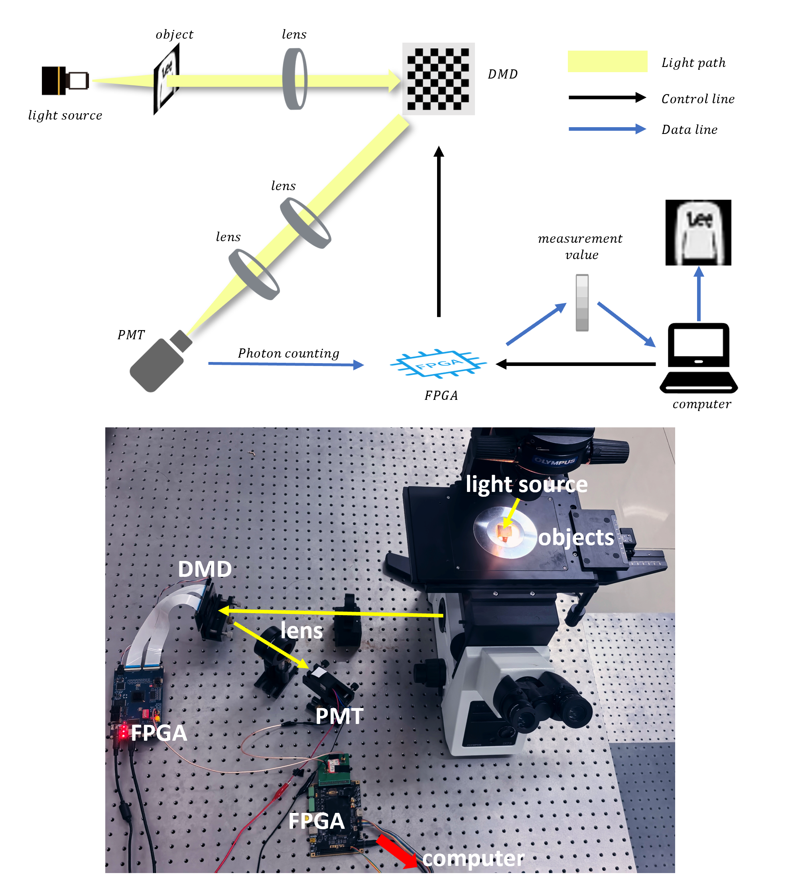

# WDNet: Dual-Branch Wavelet Diffusion for Single-Pixel Imaging

This repository is the official implementation of *"Dual-branch wavelet diffusion for single-pixel imaging"*, published in Optics Express 34(13): 24870–24887, 2026.

Single-pixel imaging (SPI) is a technique that utilizes spatial light modulation and a single-point detector to reconstruct images through computational methods. However, under ultra-low measurement rates, existing reconstruction methods still face significant challenges, such as the loss of high-frequency details and noise interference.

WDNet proposes a wavelet-domain dual-branch reconstruction method: the image is decomposed into low- and high-frequency components in the wavelet domain and reconstructed separately — the high-frequency components are restored through a lightweight network (HFRM) to recover texture details, while the low-frequency components guide a diffusion process to maintain structural stability. Experiments demonstrate that under extremely low measurement rates, WDNet achieves clearer and less noisy reconstruction results in both simulated data and real acquisition systems.

## Overview

The overall method framework (two-stage wavelet-domain dual-path reconstruction, WDNet):



The single-pixel imaging system schematic and the experimental setup:



## Project Structure

```
WDNet/
├── config.py                # 全局路径与通用配置（数据集、输出目录等）
├── data/
│   └── dataset.py           # 数据集类（ImageDataset、CustomMNIST）
├── net/                     # 网络模型模块
│   ├── measurement.py       # 压缩感知测量模块（AutoEncoder、BigConv、BinarizedNN）
│   ├── wave_t.py            # 小波变换（DWT/IDWT）
│   ├── hfrm.py              # HFRM 网络（支持 autoencoder / bigconv 两种测量方式）
│   ├── unet.py              # UNet 去噪骨干网络
│   └── diffusion.py         # DDPM 扩散模型
├── trainers/
│   └── trainer.py           # 训练器（TrainerBase、SimpleDiffusionTrainer、EarlyStopping）
├── utils/
│   ├── helpers.py           # 通用工具函数（embedding、upsample/downsample、extract 等）
│   ├── variance_schedule.py # 噪声方差调度（linear/cosine/quadratic/sigmoid）
│   └── metrics.py           # PSNR / SSIM 评估工具（命令行可用）
├── scripts/
│   ├── train_hfrm.py        # HFRM 阶段训练
│   ├── train.py             # 扩散模型阶段训练
│   ├── test_demo.py         # 演示测试（HFRM + 扩散模型完整重建）
│   ├── test_from_values.py  # 从 .mat 系统仿真测量值重建
│   └── value_to_conv.py     # .mat 测量值调试工具
├── figures/                 # 论文框架图（training.png、system.png）
├── checkpoints/             # 模型权重保存目录（自动创建）
├── loss/                    # 损失曲线图保存目录（自动创建）
└── result/                  # 重建结果保存目录（自动创建）
```

## Key Components

### HFRM (High-Frequency Reconstruction Module)
Located in `net/hfrm.py`, this module:
- Uses wavelet decomposition (DWT/IDWT) to separate image frequencies
- Implements attention mechanisms (spatial and channel attention)
- Features residual blocks with normalization
- Combines low-frequency reconstruction with high-frequency detail enhancement
- `measurement` 参数支持两种测量方式：
  - `"autoencoder"`：可学习测量卷积矩阵
  - `"bigconv"`：全图大矩阵测量，支持从预计算测量值 `forward_from_phix` 重建（测量值重建流程）

### Diffusion Model
Located in `net/diffusion.py`, this component:
- Implements a denoising diffusion probabilistic model (DDPM)
- Supports various noise schedules (linear, cosine, sigmoid, etc.)
- Works with the HFRM output (低频分量 xp_l) for conditional generation
- Includes forward and reverse diffusion processes

### UNet
Located in `net/unet.py`, this serves as the denoising backbone:
- Features time embeddings for diffusion steps
- Incorporates attention mechanisms (self-attention, cross-attention)
- Uses residual blocks with group normalization
- Includes up/downsampling operations

## Installation

1. Clone this repository
2. Install required dependencies:
   ```bash
   pip install torch torchvision torchaudio
   pip install einops tqdm
   ```

## Usage

所有脚本从项目根目录运行，路径配置见 `config.py`（如数据集目录 `DATASET_ROOT`、`.mat` 测量值目录 `MATRIX_DIR`）。

### Training HFRM
```bash
python scripts/train_hfrm.py
```
- 权重保存至 `checkpoints/BinA/best_sr{sr}.pth`
- 损失曲线保存至 `loss/BinA/`

### Training Diffusion Model
```bash
python scripts/train.py
```
- 需先训练好 HFRM，并修改脚本中加载的权重路径（默认 `checkpoints/BinA/A_best5.pth`）
- 权重保存至 `checkpoints/B_l/`

### Testing
```bash
python scripts/test_demo.py           # 完整重建流程测试
python scripts/test_from_values.py    # 从 .mat 系统仿真测量值重建
python utils/metrics.py <原图目录> <重建图目录>   # PSNR/SSIM 评估
```

Note: Ensure you have the dataset available at `../datasets/ffhq/train` (或修改 `config.py` 中的路径)。

## Model Architecture

The system follows a two-stage approach:
1. **HFRM Stage**: Reconstructs images from compressed measurements using wavelet-based frequency separation
2. **Diffusion Stage**: Further refines the reconstruction using a denoising diffusion process

## Configuration

Key parameters can be adjusted in the training scripts:
- Image size (`image_size`)
- Batch size (`batch_size`)
- Number of epochs (`epoches`)
- Learning rate (in Adam optimizer)
- Wavelet settings
- Network dimensions

Global paths are centralized in `config.py`:
- `DATASET_ROOT` / `TRAIN_FOLDER` / `DEMO_FOLDER`: 数据集路径
- `CHECKPOINT_DIR` / `LOSS_DIR` / `RESULT_DIR`: 输出目录
- `MATRIX_DIR`: 系统仿真测量值 (.mat) 目录

## Results

Trained models and logs are saved in the `checkpoints/` and `loss/` directories respectively.

## Acknowledgments

This implementation builds upon various deep learning techniques including:
- Denoising Diffusion Probabilistic Models (DDPM)
- UNet architectures
- Wavelet transforms for frequency analysis
- Attention mechanisms for feature enhancement

## Citation

If you use this code in your research, please cite:

```bibtex
@article{Wen:26,
  author  = {Zhiqiang Wen and Qiu Tu and Qiurong Yan and Siying Huang and Junyuan Yin and Junli Wu and Xiaolong Luo},
  title   = {Dual-branch wavelet diffusion for single-pixel imaging},
  journal = {Opt. Express},
  volume  = {34},
  number  = {13},
  pages   = {24870--24887},
  month   = {Jun},
  year    = {2026},
  doi     = {10.1364/OE.589959}
}
```
